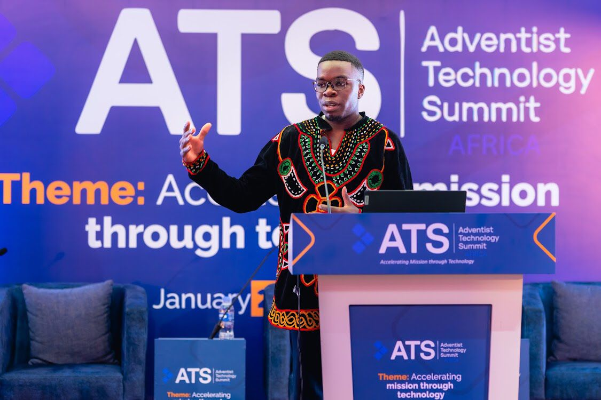

<div align="center">



# Afanyu Emmanuel — Portfolio

**Software engineer & product-minded builder based in Rwanda.**
Web apps, cross-platform mobile and analytics dashboards that balance business needs with scalable engineering.

[**🌐 Live site**](https://afanyu.netlify.app) · [**📅 Book a call**](https://calendly.com/aemmanueldelonie/30min) · [**📄 Download CV**](https://afanyu.netlify.app/cv.pdf) · [**✉️ Email**](mailto:aemmanueldelonie@gmail.com)


[](https://github.com/Afanyu-Emmanuel-Delonie/afa-main-portofolio/actions/workflows/node.js.yml)

</div>

---

## ✨ Overview

This is my personal portfolio and freelance service site. It's both a showcase of my work and a client-facing landing page — visitors can browse projects and case studies, see how I work, and reach me in one click via WhatsApp, email or Calendly.

### Highlights

- **Bilingual (EN / FR)** — every section is translated, with a language switch powered by a lightweight React context.
- **Prerendered for SEO** — each route is rendered to static HTML at build time, so search engines and AI crawlers see real content, not an empty SPA shell.
- **Rich SEO setup** — per-page meta via a `useSEO` hook, Open Graph & Twitter cards, JSON-LD `Person` schema, sitemap, `robots.txt`, `llms.txt` and `humans.txt`.
- **Project case studies** — every project has its own detail page (`/projects/:id`) driven by a single data file.
- **Smooth, dependency-light animations** — custom `IntersectionObserver` scroll reveals plus Motion for richer transitions.
- **Real 404 handling** — a proper not-found page served with a genuine 404 status.
- **CI on every push** — GitHub Actions builds the site on Node 18, 20 and 22.

---

## 🧱 Tech Stack

| Layer        | Technology                                           |
| ------------ | ---------------------------------------------------- |
| Framework    | React 18 (JSX)                                       |
| Routing      | React Router 7                                       |
| Build tool   | Vite 6 + custom prerender step                       |
| Styling      | Tailwind CSS v4 (`@tailwindcss/vite`)                |
| UI & icons   | Radix UI primitives, Lucide React                    |
| Animation    | Motion + custom scroll-reveal hook                   |
| i18n         | Custom `LanguageContext` (English & French)          |
| Contact      | WhatsApp, email and Calendly                         |
| Hosting / CI | Netlify · GitHub Actions                             |

---

## 🚀 Getting Started

**Prerequisites:** Node.js 18+ and npm.

```bash
git clone https://github.com/Afanyu-Emmanuel-Delonie/afa-main-portofolio.git
cd afa-main-portofolio
npm install
npm run dev        # http://localhost:5173
```

| Script          | What it does                                                    |
| --------------- | --------------------------------------------------------------- |
| `npm run dev`   | Start the Vite dev server                                       |
| `npm run build` | Production build, then prerender every route (`postbuild`)      |
| `npm test`      | Placeholder — no tests yet                                      |

---

## 🗺️ Routes

| Path             | Page                                    |
| ---------------- | --------------------------------------- |
| `/`              | Home — all landing sections             |
| `/about`         | Extended about page                     |
| `/projects/:id`  | Project case study                      |
| `*`              | 404 Not Found                           |

The home page renders, in order: **Nav → Hero → Stats → About → Services → Tech Stack → Projects → Journey → How I Work → Testimonials → Contact → FAQ → CTA → Footer**.

---

## 📁 Project Structure

```
afa-main-portofolio/
├── .github/workflows/      # CI build on Node 18 / 20 / 22
├── public/                 # cv.pdf, og-image, robots, llms.txt, manifest, _headers
├── scripts/
│   ├── prerender.mjs       # Renders each route to static HTML after build
│   └── generate-og-image.mjs
├── src/
│   ├── app/
│   │   ├── components/     # Page sections (Hero, Projects, Contact…) + ui/ primitives
│   │   ├── pages/          # AboutPage, ProjectDetailPage, NotFound, Design pages
│   │   └── App.jsx         # Routes + home layout
│   ├── context/            # LanguageContext (EN/FR)
│   ├── data/               # projects, design work, testimonials, translations
│   ├── hooks/              # useSEO, useScrollReveal
│   ├── assets/             # Images & project screenshots
│   ├── index.css           # Tailwind v4 config, fonts, keyframes
│   └── main.jsx
├── index.html              # Base meta, Open Graph, JSON-LD
├── netlify.toml            # Build config & redirects
└── vite.config.js
```

---

## 🛠️ Customising Content

All content is data-driven — no component edits needed for day-to-day updates.

| To change…            | Edit                          |
| --------------------- | ----------------------------- |
| Projects & case studies | `src/data/projects.js`      |
| Design work           | `src/data/design.js`          |
| Testimonials          | `src/data/testimonials.js`    |
| Any text (EN / FR)    | `src/data/translations.js`    |
| CV                    | `public/cv.pdf`               |
| Social preview image  | `public/og-image.png` (1200×630) |

### Adding a project

```js
{
  id: 'unique-slug',              // becomes /projects/unique-slug
  title: 'Project Name',
  desc: 'Short description shown on the card.',
  stack: ['React', 'Django'],
  live: 'https://…',
  github: 'https://…',
  color: 'from-blue-500/20 to-purple-500/20', // card banner gradient
  caseStudy: {
    overview: '…',
    problem: '…',
    solution: '…',
    outcome: '…',
    sections: [{ heading: 'Section Title', body: 'Section content.' }],
  },
}
```

The first three projects are featured on the home page; the rest appear under **View all projects**. Remember to add new routes to the sitemap so they're indexed.

---

## 🌍 Deployment

The site deploys to **Netlify** from `main`:

- Build command: `npm run build` · Publish directory: `dist` · Node 20
- Every route is prerendered to `dist/<route>/index.html`, so no SPA catch-all redirect is needed.
- When the custom domain goes live, update the canonical URL in `index.html`, the JSON-LD, `robots.txt`, the sitemap and the redirect in `netlify.toml`.

---

## 📬 Contact

- **Website:** [afanyu.netlify.app](https://afanyu.netlify.app)
- **Email:** [aemmanueldelonie@gmail.com](mailto:aemmanueldelonie@gmail.com)
- **Calendly:** [Book a 30-minute call](https://calendly.com/aemmanueldelonie/30min)
- **Location:** Rwanda 🇷🇼

---

## 📄 License

This is a personal project and is not open for redistribution. All content, images and copy © Afanyu Emmanuel. Third-party credits are listed in [`ATTRIBUTIONS.md`](ATTRIBUTIONS.md).
